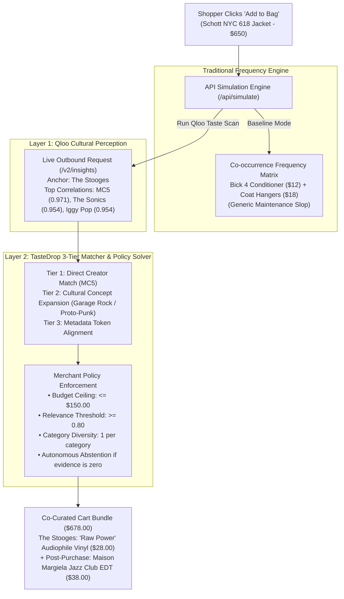

# TasteDrop // The Cultural Cart Agent

> **"Checkout is the highest-intent moment in e-commerce. Most stores waste it on shoe grease."**
> 
> *TasteDrop uses Qloo's cultural taste graph to replace maintenance commodities with cross-domain lifestyle companions.*

---

## 🏆 Official Hackathon Information

* **Hackathon:** Qloo Agentic Hackathon — *"Agents, but with taste"*
* **Platform:** Devpost (`qloo.devpost.com`)
* **Track:** Primary Autonomy & Cultural Grounding Track
* **Live Production URL:** **[https://tastedrop-433o.vercel.app](https://tastedrop-433o.vercel.app)**
* **Public GitHub Repo:** **[https://github.com/reachmeghanashyam-coder/tastedrop](https://github.com/reachmeghanashyam-coder/tastedrop)**
* **Sponsor Tooling:** Direct Qloo Taste AI™ API connectors (`/v2/insights` and `/search`) + Model Context Protocol (MCP) canonical tool bindings (`lib/qloo-mcp.ts`)
* **Verification:** Zero-dependency automated test runner (**13/13 passing green** in <400ms) covering deterministic schemas, 3-tier cultural taxonomy matching, causality controls, and adversarial inversion.

---

## 1. The Human Problem

When a shopper invests **$650 in an iconic Schott NYC 618 leather motorcycle jacket**, what does traditional e-commerce recommend at checkout?
* *A $12 bottle of Bickmore leather conditioner and an $18 pack of wooden coat hangers.*

Nothing about that is broken, but it is culturally blind. Traditional algorithms optimize for **co-purchase maintenance**—what people buy to clean or maintain an item. Pitching a cheap bottle of shoe grease to someone purchasing a legendary rock-and-roll heritage piece degrades the luxury brand experience.

A customer buying a Schott 618 isn't buying cowhide. They are buying into **1970s CBGB proto-punk counterculture**. They don't want coat grease; they want the cultural universe surrounding that piece.

---

## 2. What TasteDrop Does: The Two-Layer Architecture

TasteDrop bridges the gap between raw merchant catalogs and cultural affinity matching through a transparent two-layer architecture:



1. **Layer 1: Qloo Cultural Perception:** Queries `https://hackathon.api.qloo.com/v2/insights` in real time (~270ms latency) to retrieve raw cultural correlation scores.
2. **Layer 2: Retail Merchandising Engine:**
   - **Tier 1:** Direct Creator Matching (`MC5`).
   - **Tier 2:** Cultural Concept Expansion (The Sonics $\to$ `garage-rock` $\to$ connects catalog tags with auditable lineage).
   - **Tier 3:** Metadata Token Alignment.
   - **Deterministic Policy Solver:** Enforces hard spend ceilings ($\le \$150$), relevance gates ($\ge 0.80$), and category deduplication.
   - **Autonomous Abstention:** If a query has zero cultural overlap with the catalog, the agent commits **0 items** and logs an explicit abstention trail.

---

## 3. Technology Stack & Forensic Verification

* **Frontend:** Next.js 15.1.7 (App Router), React 19, TypeScript, Tailwind CSS, Framer Motion.
* **Audio Feedback:** Native Web Audio API organic harmonic chimes (580Hz / 640Hz) upon scan and checkout resolution.
* **Qloo Integration:** Authenticated server-side HTTPS calls with 4-second timeout protection and typed statuses (`LIVE_SUCCESS`, `AUTHENTICATION_ERROR`, `NETWORK_ERROR`, `INVALID_RESPONSE`).
* **Decision Lab (Glass Back Door):** Inspectable real-time telemetry drawer showing live latency, candidate acceptance/rejection trails, relationship provenance, and copyable cURL trace.
* **Automated Verification:** 13 zero-dependency tests running natively via Node.js (`npm test`):
  - *Adversarial Inversion:* Poison inputs, null states, oversized numbers (`inversion.test.js`).
  - *Concurrency & Idempotency:* Parallel invocation safety (`concurrency.test.js`).
  - *Controlled Causality:* Controlled experiments proving unrelated entities (Bach) force rejection (`causality.test.js`).
  - *3-Tier Cultural Taxonomy:* Proving concept expansion and taxonomy removal integrity (`taxonomy.test.js`).
  - *Catalog Arithmetic:* Verifying exact $650 + $28 = $678 basket totals (`catalog.test.js`).

---

## 4. Getting Started Locally

```bash
# 1. Clone the repository
git clone https://github.com/reachmeghanashyam-coder/tastedrop.git
cd tastedrop

# 2. Install dependencies
npm install

# 3. Configure Qloo API Key in .env.local
QLOO_API_KEY=your_key_here

# 4. Run automated test suite (13/13 Passing Green)
npm test

# 5. Build and run production server
npm run build
npm run start
```

Open [https://tastedrop-433o.vercel.app](https://tastedrop-433o.vercel.app) to view the live production deployment (or run locally at `http://localhost:3000`).
