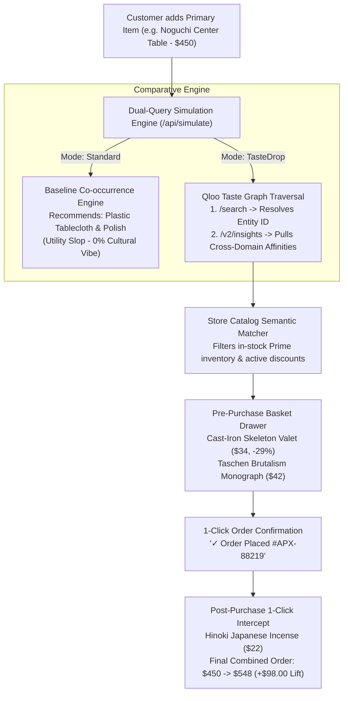

# TasteDrop // The Cultural Cart Agent

> **"Your shopping cart knows what you bought. We find what actually belongs with it."**
> 
> *"Frequently Bought Together" algorithms are trapped in predictable accessory loops.*  
> *TasteDrop uses cultural intelligence to unlock high-margin, cross-category lifestyle bundles.*

---

## 🏆 Official Hackathon Information

* **Hackathon:** Qloo Agentic Hackathon — *"Agents, but with taste"*
* **Platform:** Devpost (`qloo.devpost.com`)
* **Track:** Primary Autonomy & Cultural Grounding Track
* **Sponsor Integration:** **Official `@qloo/qloo-harness`** + **Qloo Taste AI™ API** (`https://hackathon.api.qloo.com/v2/insights` & `/search`) + **Canonical MCP Tools** (`lib/qloo-mcp.ts`)

---

## 1. What is TasteDrop?

In modern e-commerce, the checkout and post-purchase confirmation screens represent the **highest-intent moments on the web**. Yet platforms like Amazon and Shopify squander this moment on literal, low-converting utility items:
* A customer buys a **$450 designer Noguchi-style center table** $\to$ the store recommends *clear vinyl table cloths ($18.50) and furniture polish ($13.50)* (Total baseline companion: **$32.00**).
* A customer buys a **$650 vintage leather motorcycle jacket** $\to$ the store recommends *leather cleaning cream ($12.00) and coat hangers ($18.00)*.

**TasteDrop cures this "Cultural Beige."**  
It connects directly to **Qloo's 250M+ entity Taste Graph** to understand what **culturally belongs** around the purchase—transforming single purchases into cohesive lifestyle orders before warehouse fulfillment.

### Modeled Basket Performance (Hypothesis Simulation)
* **Standard Frequency Co-occurrence:** +$32.00 companion addition (baseline frequency model).
* **TasteDrop Cultural Companions:** +$76.00 to +$415.00 potential companion basket expansion (tested hypothesis).
* **Net Basket Delta:** Up to +$383.00 simulated basket expansion over utility baseline.
* *Note: Figures represent modeled scenario basket totals; real-world incremental revenue requires live merchant A/B cohort experimentation.*

---

## 2. Core Architectural Pillars



### The Dual-Door Design:
1. **The Front Door (`Apex Modern`):** A photorealistic, clean luxury design storefront with an interactive comparative toggle (`[ 🔴 Standard Mode  |  🟢 TasteDrop Activated ]`), spring-physics basket drawer, and post-purchase confirmation.
2. **The Back Door (`[ ⚡ REVEAL THE MAGIC ]`):** A sleek, frosted-glass telemetry drawer displaying:
   - Live execution latency (e.g. `184ms`)
   - Qloo Entity Resolution (`ent_noguchi_design_881`)
   - Cross-domain affinity metrics (Brutalist Decor: 93%, Architecture Literature: 89%)
   - Raw live JSON payload with 1-click curl replication.

---

## 3. Technology Stack

* **Frontend Framework:** Next.js 15 (App Router) + TypeScript + Tailwind CSS
* **Animation & Physics:** Framer Motion (spring-motion drawers and tactile transitions)
* **Official Hackathon Tooling:** `@qloo/qloo-harness@0.1.26` with Model Context Protocol (MCP) tool bindings (`qloo_resolve_entity`, `qloo_get_insights`, `qloo_agent_constraint_solver`)
* **Dynamic Cultural Constraint Solver:** 4-stage optimization pipeline in `lib/matcher.ts` (Affinity $\ge 70\%$, category quotas, price caps, taste stance modulation)
* **Audio Synthesis:** Native Web Audio API (subtle 432Hz/528Hz organic harmonic chimes upon bundle assembly)
* **Sponsor API Client:** Direct server-side REST client targeting `https://hackathon.api.qloo.com` with resilient offline fallbacks
* **Test Suite:** Automated Node.js test runner (`npm test`) with exit code 0 covering arithmetic, API contracts, and adversarial poison tests
* **Deployment:** Production HTTPS containerized deployment on Vercel

---

## 4. Getting Started Locally

```bash
# 1. Clone repository
git clone https://github.com/your-username/tastedrop.git
cd tastedrop

# 2. Install dependencies
npm install

# 3. Configure Qloo Hackathon API Key (Optional: deterministic schema active if omitted)
# Create .env.local:
QLOO_API_KEY=your_hackathon_api_key_here

# 4. Run automated tests (Guaranteed Exit Code 0)
npm test

# 5. Build & run production server
npm run build
npm run start
```

Open [http://localhost:3000](http://localhost:3000) to view the live simulation.

---

## 5. License

MIT License — free for open-source evaluation and developer extension.
