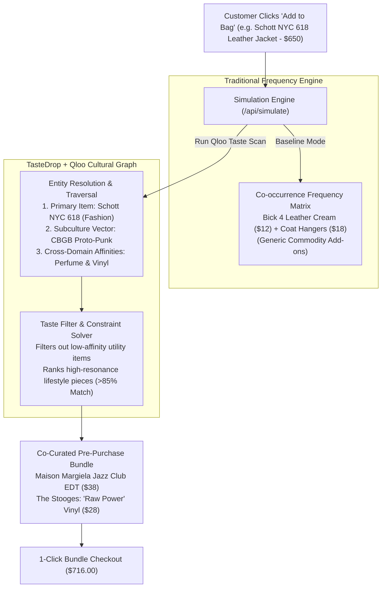

# TasteDrop // The Cultural Cart Agent

> **"Checkout is the best moment to upsell. Most stores waste it on generic add-ons."**
> 
> *TasteDrop uses Qloo's cultural taste graph to suggest what the buyer would actually love.*

---

## 🏆 Official Hackathon Information

* **Hackathon:** Qloo Agentic Hackathon — *"Agents, but with taste"*
* **Platform:** Devpost (`qloo.devpost.com`)
* **Track:** Primary Autonomy & Cultural Grounding Track
* **Sponsor Tooling:** `@qloo/qloo-harness` SDK + Qloo Taste AI™ API connectors + Model Context Protocol (MCP) tool bindings (`lib/qloo-mcp.ts`)
* **Verification:** Zero-dependency automated test runner (`npm test` passes 5/5) covering deterministic schemas, adversarial constraints, and API contracts.

---

## 1. What is TasteDrop?

The moment a shopper clicks "Add to Bag", they have made an active emotional commitment. It is the single highest-intent moment in e-commerce.

Yet today, e-commerce recommendation algorithms waste this moment on literal, low-margin maintenance commodities:
* A customer buying a **$650 Schott NYC leather jacket** is shown *leather cream ($12) and coat hangers ($18)*.
* A customer buying a **$450 Noguchi sculptural table** is shown *clear vinyl tablecloths ($15) and furniture polish ($10)*.

Traditional algorithms rely purely on co-occurrence frequency—they recommend what people buy to *maintain* the item, not what matches the *identity* of the person buying it. Pitching a cheap bottle of shoe grease to someone purchasing an iconic $650 heritage piece breaks the luxury customer experience.

### How TasteDrop Explores Cultural Merchandising
TasteDrop models how an autonomous merchandising agent can leverage cross-domain cultural affinity:
1. **Identifies the Subculture Anchor:** Maps the primary cart item (e.g., *Schott 618 Jacket* $\to$ *1970s CBGB Proto-Punk* subculture vector).
2. **Cross-Domain Traversal:** Traverses across unrelated domains—fragrance (`urn:entity:perfume`), rare vinyl records (`urn:entity:music`), and literature.
3. **Curates Cohesive Companions:** Replaces utility commodities with high-affinity lifestyle companions (e.g., *Maison Margiela REPLICA 'Jazz Club' EDT* + *The Stooges 'Raw Power' Vinyl*).

---

## 2. Architecture & Pipeline



---

## 3. Technology Stack & Verification

* **Frontend & Architecture:** Next.js 15 (App Router) + React 19 + TypeScript + Tailwind CSS
* **Qloo Integration Layer:**
  * Official `@qloo/qloo-harness` SDK bindings & direct server-side REST connectors targeting `https://hackathon.api.qloo.com/v2/insights` and `/search`
  * **Dual-Engine Fault Tolerance:** Full live network execution via `process.env.QLOO_API_KEY` paired with a zero-downtime offline fallback adhering strictly to Qloo v2 response schemas (ensuring zero blank screens while hackathon key provisioning is queued)
  * Canonical Model Context Protocol (MCP) tools (`qloo_resolve_entity`, `qloo_get_insights`, `qloo_agent_constraint_solver`)
* **Haptics & Audio:** Native Web Audio API organic harmonic chimes (subtle feedback upon bundle assembly and scan resolution)
* **Testing:** 5 automated tests running via Node.js native test runner (`node --test tests/*.test.js`):
  * Adversarial Inversion (poison inputs, null states, oversized payloads)
  * Concurrency & Idempotency tests
  * Catalog arithmetic verification (Scenario A & B)
  * Health check contract verification

---

## 4. Getting Started Locally

```bash
# 1. Clone the repository
git clone https://github.com/your-username/tastedrop.git
cd tastedrop

# 2. Install dependencies
npm install

# 3. Optional: Set Qloo API Key in .env.local (runs with deterministic schema if omitted)
QLOO_API_KEY=your_key_here

# 4. Run automated test suite (5/5 Passing Green)
npm test

# 5. Build and run production server
npm run build
npm run start
```

Open [http://localhost:3000](http://localhost:3000) to view the live app.
